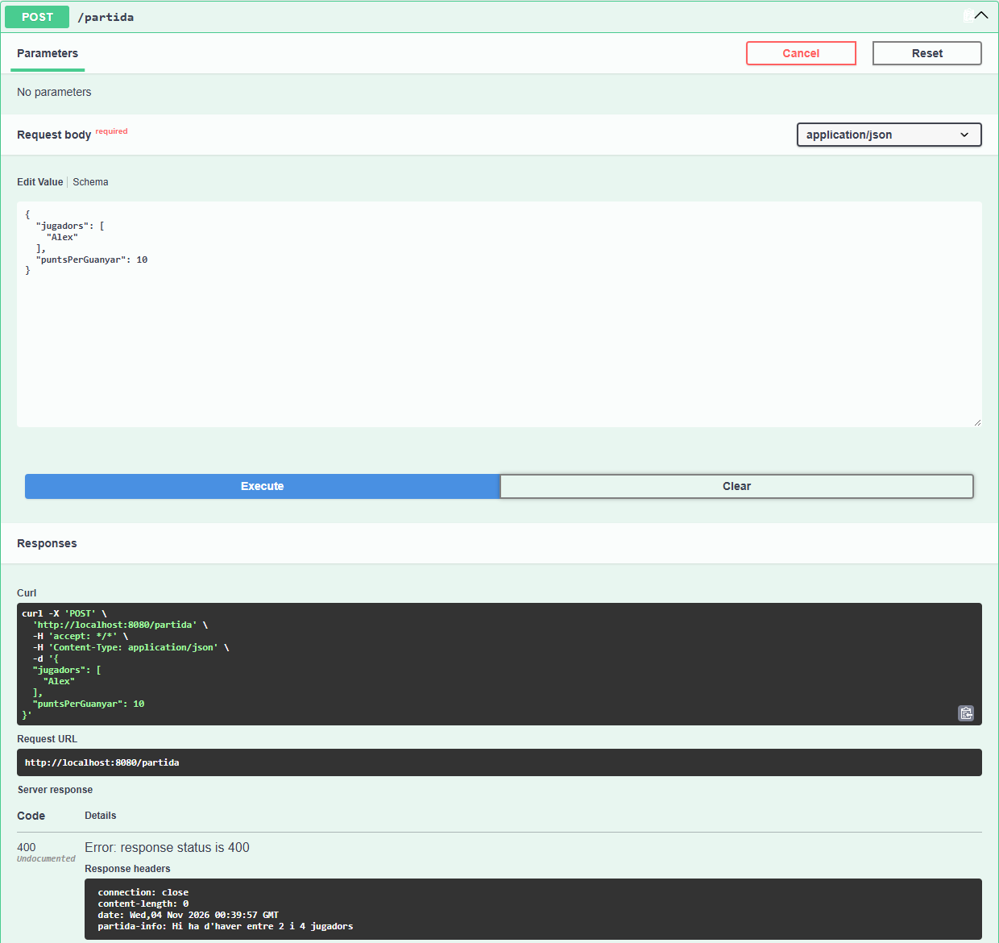
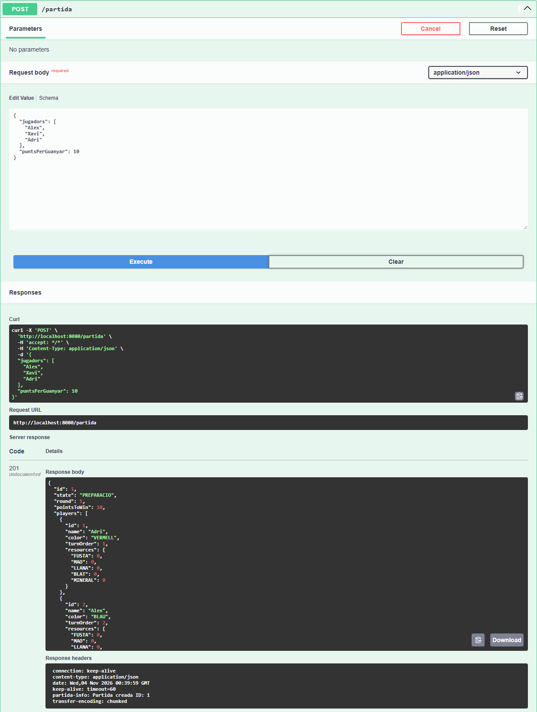
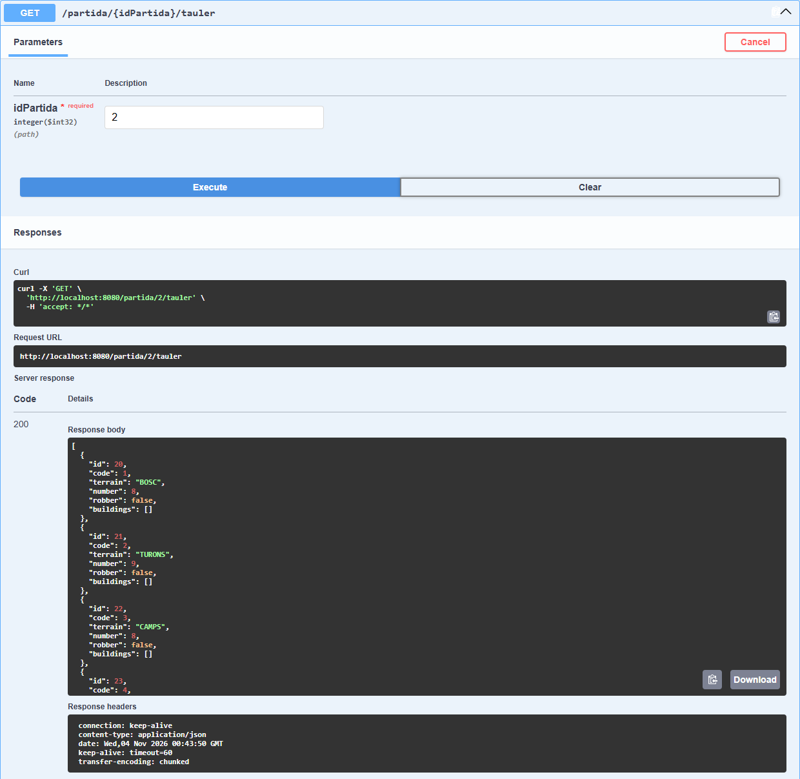
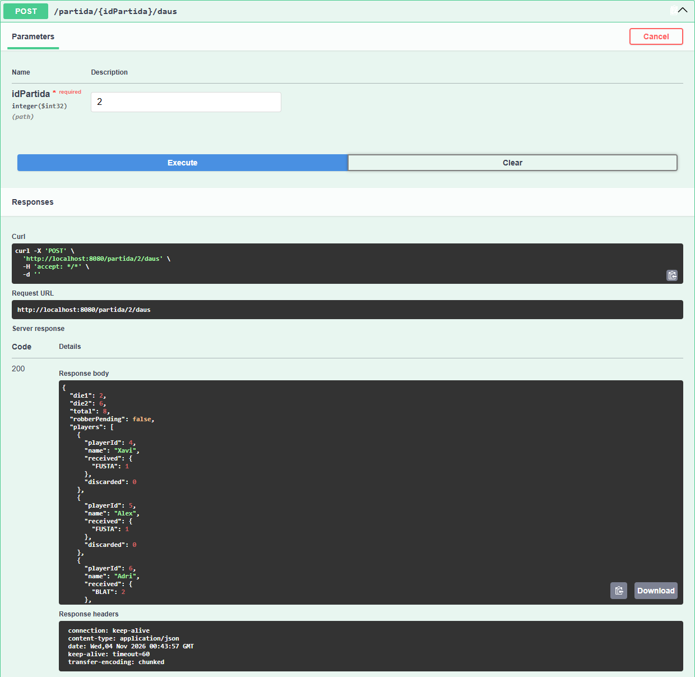
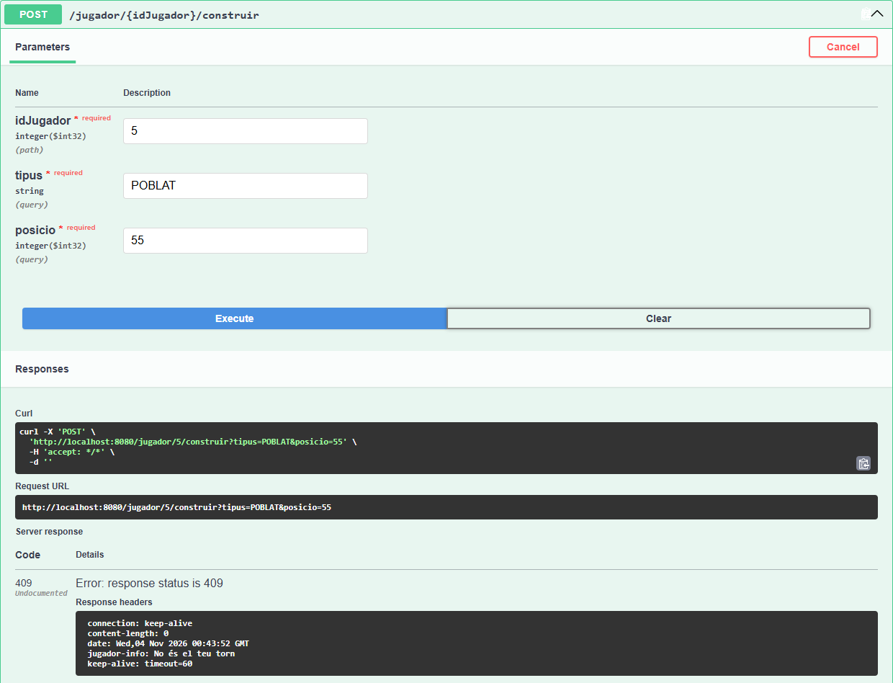
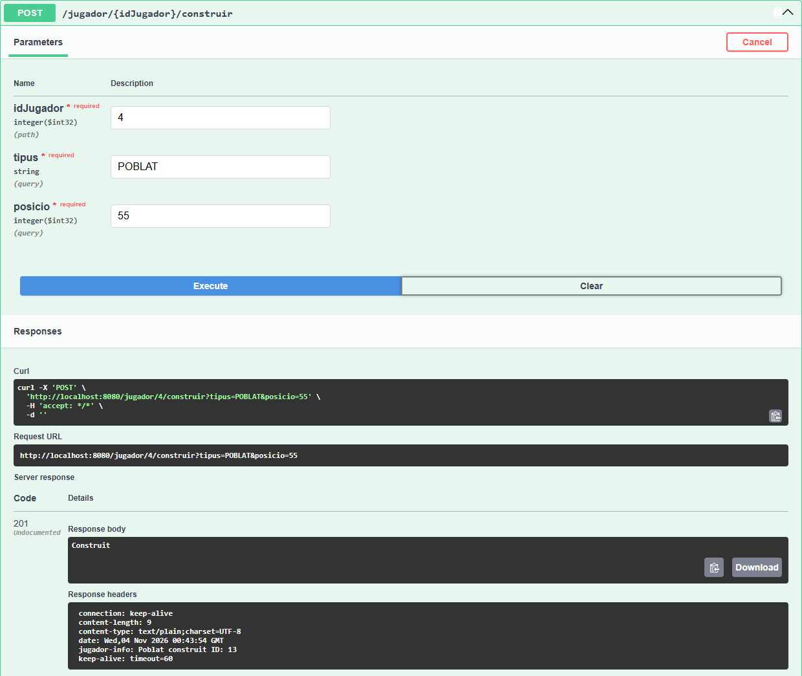
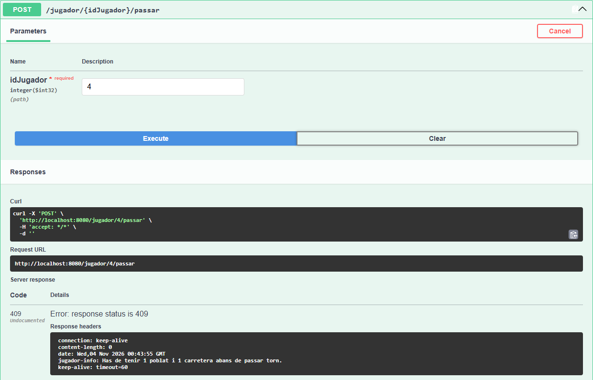
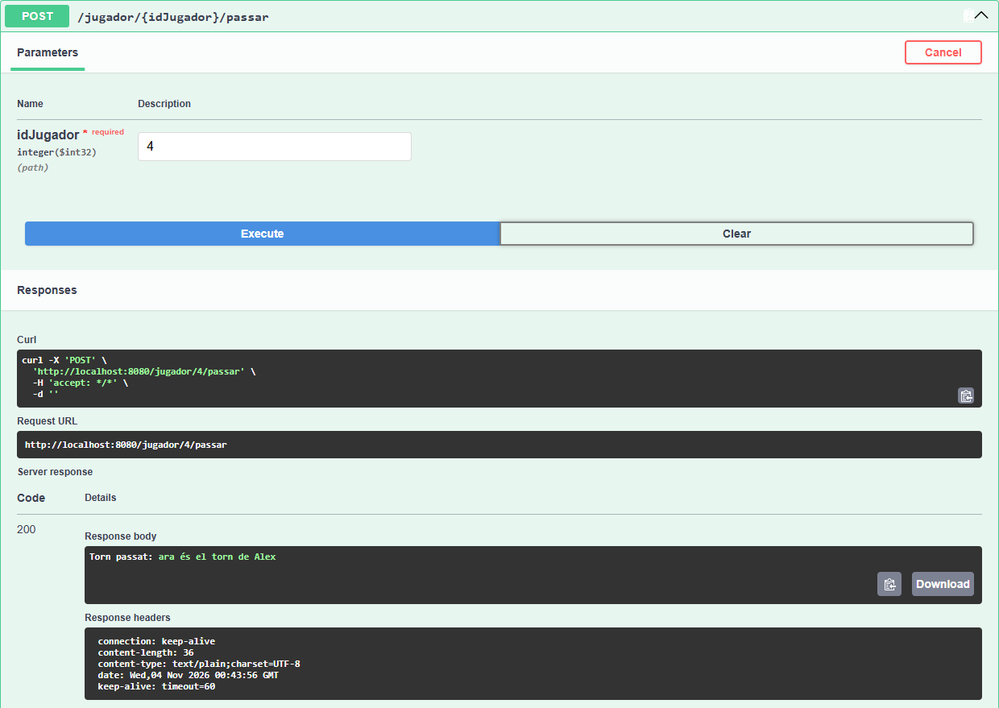
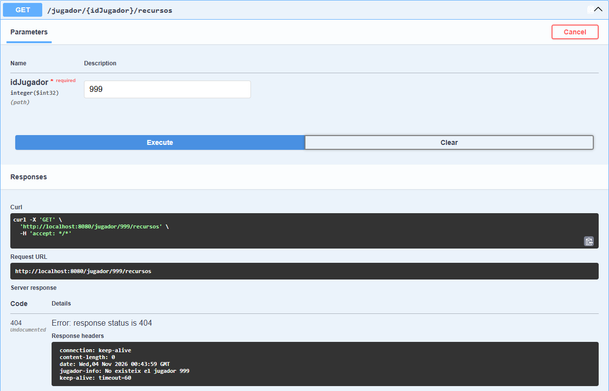
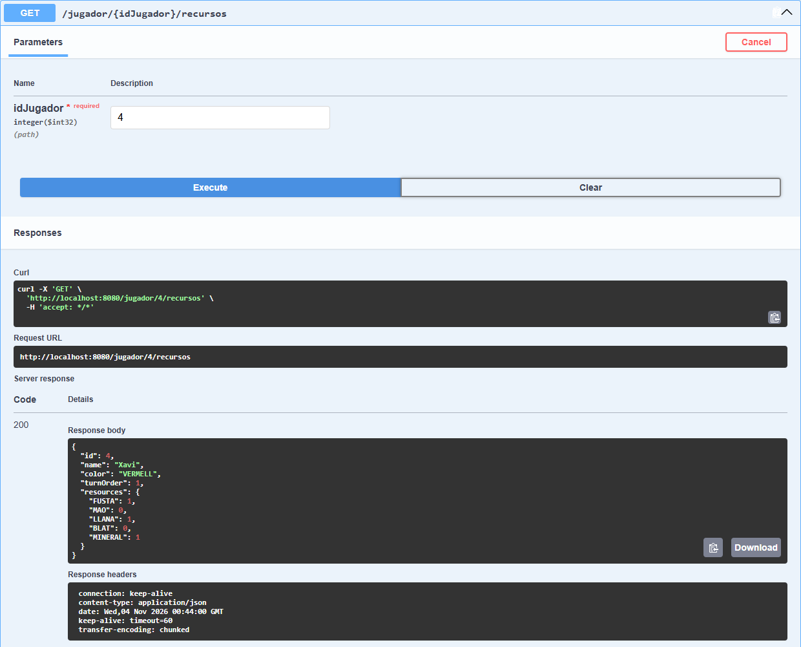

# Decisiones tomadas

1. Empezamos haciendo mal los repositories, pensando que solo tendiramos que hacer uno para jugador y otro para partida. Despues de analizar el problema con prueba y error, llegamos a la conclusión de que necesitábamos un repository para cada entidad.
2. Repartimos el trabajo entre los 3 integrantes:
   1. Xavi y Alex: Cada uno, la mitad de PartidaService.
   2. Adri: JugadorService
3. Seguimos atentamente la documentación de la práctica, traduciendo método a método de Hibernate a Spring.
4. Decidimos usar DTO en lugar de atributos como `@JsonIgnore` o `@JsonManagedReference`, ya que el ejemplo de Videojocs lo implementa así y consideramos que sería la opción más limpia y escalable.
5. Inicialmente devolviamos objetos sin ResponseEntity en los Controllers, pero despues consideramos que era mejor devolver ResponseEntity ya que evita errores opacos a la hora de hacer peticiones.
6. Usamos headers personalizados para devolver mensajes de error y de éxito en las peticiones.

# Documento de pruebas

## `POST /partida`

**Error:** Crear partida con 1 jugador: 400

**Correcto:** Crear partida con 3 jugadores: 201

## `GET /partida/{idPartida}/tauler`

**Error:** Partida inexistente: 404

**Correcto:** Tablero de la partida: 200

## `POST /partida/{idPartida}/daus`

**Error:** Tirar dados durante la preparación: 409

**Correcto:** Tirar dados con la partida en curso: 200

## `POST /jugador/{idJugador}/construir`

**Error:** Construir fuera de tu turno: 409

**Correcto:** Construir un poblado en tu turno: 201

## `POST /jugador/{idJugador}/passar`

**Error:** Pasar turno sin haber colocado la carretera: 409

**Correcto:** Pasar turno tras colocar poblado y carretera: 200

## `GET /jugador/{idJugador}/recursos`

**Error:** Jugador inexistente: 404

**Correcto:** Recursos del jugador: 200

